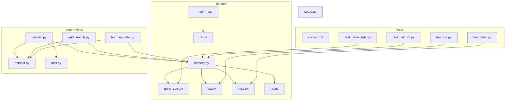

# Detecting Footprints Containing Motifs (DeFCoM)

This respository includes the source code for the DeFCoM supervised ML genomic footprint classification framework described in [this publication](https://doi.org/10.1093/bioinformatics/btw740). If you use this tool in your research, please include the following citation:

> Quach, B., & Furey, T. S. (2017). DeFCoM: analysis and modeling of transcription factor binding sites using a motif-centric genomic footprinter. Bioinformatics, 33(7), 956-963.

_Note:_ This framework has not been maintained since 2017 and was written in Python 2.7. Please reach out if you are interested in collaborations to refactor the codebase. The `manuscript` branch includes source files that correspond to the [manuscript version](https://doi.org/10.1093/bioinformatics/btw740) of the tool.

## Documentation

For a general overview of genomic footprinting see this review by [Sung _et al._(2016)](https://doi.org/10.1038/nmeth.3766). DeFCoM was designed to learn patterns for chromatin accessibility signals at transcription factor binding sites across the genome from DNaseI-seq or ATAC-seq data. These learned transcription factor binding patterns can then be used to predict binding sites in new DNaseI-seq or ATAC-seq samples. The following image provides an overview of the DeFCoM framework:

For detailed documentation see the [Read the Docs page](https://defcom.readthedocs.io/en/latest/).

## Developer notes

Code structure (arrows represent dependencies based on import statements):

